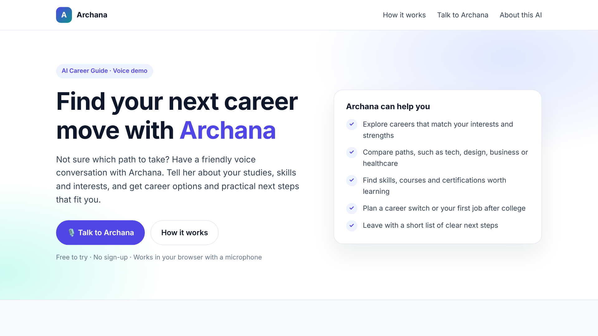
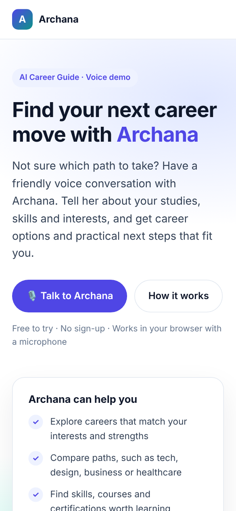

# Archana – AI Career Guide 🎙️

**A voice AI agent that helps students and professionals explore career options. Visitors talk to it directly in the browser.**

Archana listens to a visitor's background (education, skills, experience and interests) and suggests suitable career paths and practical next steps, all through a natural spoken conversation.

🔗 **Live demo:** https://nuthana03jain-ctrl.github.io/voice-agent/

> ℹ️ Archana is an AI assistant built for demo purposes. Its suggestions are general guidance, not professional career counselling.

---

## Screenshots

| Desktop | Mobile |
|---|---|
|  |  |

*Visitors start a voice call using the ElevenLabs call button in the bottom-right corner of the page.*

---

## Features

- 🗣️ **Real-time voice conversation** with an AI career guide, right in the browser
- 🎯 **Personalised guidance:** career paths and next steps based on what the user shares
- 👥 **Built for every stage:** students, working professionals and career switchers
- 📱 **Responsive design** that works on desktop and mobile
- 🔒 **No backend and no API keys:** uses only the agent's public ID
- ⚡ **Single file:** the whole site is one `index.html`, with no build step or dependencies

## How it works

1. **Talk:** the visitor taps the call button and allows microphone access.
2. **Share your background:** they describe their studies, skills, experience and interests.
3. **Get career paths and next steps:** Archana suggests suitable roles plus concrete actions, such as skills to learn or roles to explore.

### Architecture

```
 Visitor's browser                          ElevenLabs (cloud)
┌──────────────────────────┐   voice    ┌──────────────────────────────┐
│ index.html               │ ─────────▶ │ Conversational AI agent      │
│  └─ <elevenlabs-convai>  │            │  • Speech-to-text            │
│     widget (mic + audio) │ ◀───────── │  • LLM + career-guide prompt │
└──────────────────────────┘   voice    │  • Text-to-speech            │
                                        └──────────────────────────────┘
```

The page embeds the official **ElevenLabs Conversational AI widget**:

```html
<elevenlabs-convai agent-id="agent_6801m729tjz6ezd8vvgm43fsn64a"></elevenlabs-convai>
<script src="https://unpkg.com/@elevenlabs/convai-widget-embed" async type="text/javascript"></script>
```

- `<elevenlabs-convai>` is a custom HTML element. Its `agent-id` points to the Archana agent. The ID is public (like an address), not a secret key.
- The script loads the widget from the unpkg CDN. The widget handles microphone access, the live connection, and audio playback.
- Speech recognition, the AI's responses and the voice are processed by ElevenLabs, so the site needs no server of its own.

## Tech stack

| Area | Tools |
|---|---|
| Voice AI agent | [ElevenLabs Conversational AI](https://elevenlabs.io/docs/eleven-agents): prompt, voice, first message, language |
| Frontend | HTML5, CSS3 (Flexbox, Grid, media queries), no frameworks |
| Hosting | GitHub Pages |

## My role

- **Designed the agent:** wrote Archana's system prompt and conversation flow (greet → learn the user's background → suggest career paths → give next steps), and configured its voice, first message and language in ElevenLabs.
- **Built the website:** a clean, responsive landing page with a hero section, audience cards, a "How it works" section and a clear AI disclaimer.
- **Integrated and deployed:** embedded the agent using only its public ID (no API keys exposed) and published the site with GitHub Pages.

## Run it locally

No installation needed.

```bash
git clone https://github.com/nuthana03jain-ctrl/voice-agent.git
```

```bash
cd voice-agent
```

```bash
python3 -m http.server 8000
```

Then open http://localhost:8000 in Chrome, Edge or Safari, click the call button in the bottom-right corner, and allow microphone access.

> Browsers only allow microphone access on `https://` sites or `localhost`, so serve the page as shown instead of double-clicking the file.

## What I learned

- How conversational voice AI works end to end: speech-to-text, a language model, and text-to-speech
- Writing effective prompts that keep an AI agent focused, helpful and safe
- The difference between a public agent ID and a secret API key, and why keys never belong in frontend code
- Building responsive layouts with CSS Grid and media queries
- Deploying a static site with GitHub Pages

## Roadmap

- [ ] Lead capture form (for example, saving name and email to a Google Sheet)
- [ ] Hindi and English language options
- [ ] FAQ section and sample questions to ask Archana
- [ ] Knowledge base with course and career resources for more specific answers

## Disclaimer

Archana is an AI assistant built for learning and demo purposes. It is not a human career counsellor, and its responses may be inaccurate or incomplete. Please verify important decisions with a qualified counsellor or official sources, and avoid sharing sensitive personal information during conversations. Voice conversations are processed by ElevenLabs.
